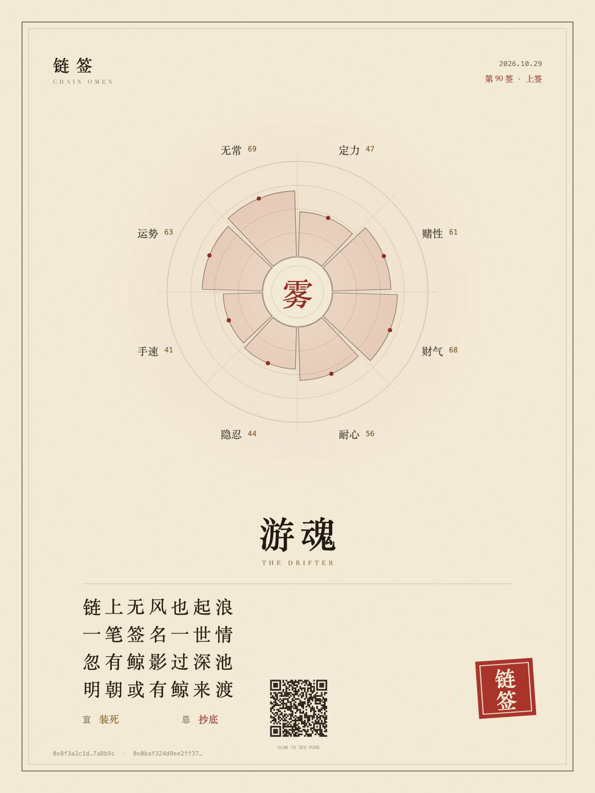
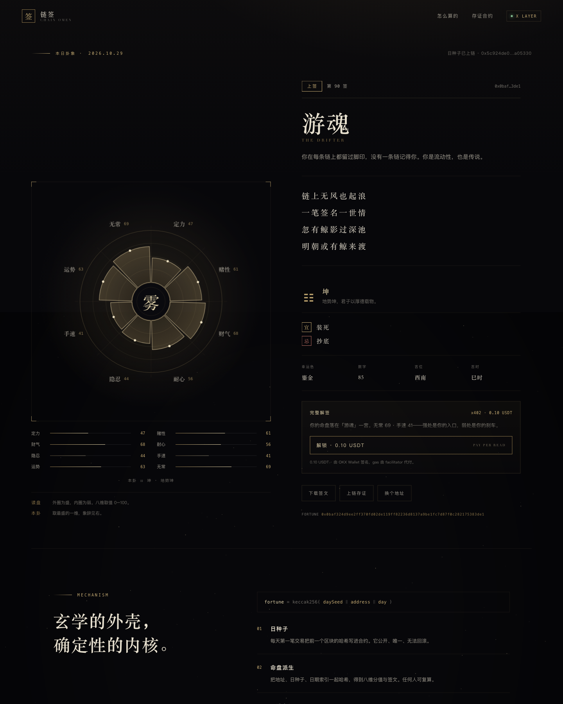
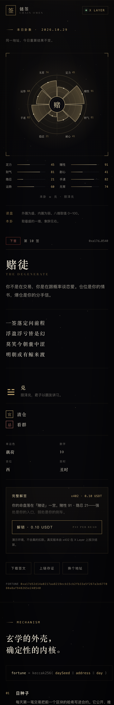

# 链签 · CHAIN OMEN

> 你的钱包，今天想说什么？

一个跑在 X Layer 上的「每日一签」。输入地址，用**当日区块种子 + 地址 + 日期**派生一张八维命盘；签文可以下载成图，可以上链存证，完整解签用 x402 按次付费。

不是随机数，是命——同一天、同一地址，永远是同一卦；过了子时（UTC+8 零点），卦象重排。

**已部署在 X Layer 主网：** [`0x5d07f0386d53f99bacd6baaf85c289201313565a`](https://www.oklink.com/xlayer/address/0x5d07f0386d53f99bacd6baaf85c289201313565a)

**GitHub Pages（永久静态站）：** [yaetcc.github.io/chain-omen](https://yaetcc.github.io/chain-omen/?a=0x8f3a2c1d4e5b6a7c8d9e0f1a2b3c4d5e6f7a8b9c)

**在线预览（临时隧道，含 x402 API）：** [wars-tried-places-organization.trycloudflare.com](https://wars-tried-places-organization.trycloudflare.com/?a=0x8f3a2c1d4e5b6a7c8d9e0f1a2b3c4d5e6f7a8b9c)

> Pages 上只有静态前端，解锁会回退成本地演示；完整支付 API 走临时隧道或下面的 Render。隧道从本机起，进程结束或机器休眠就会失效。页面左下角有 `DEMO · 支付未接通真实结算` 标记——当前 facilitator 是 mock，不会真的收款。



---

## 为什么是它

- **每日仪式感**：不是一次性 mint，而是每天都会想回来看一眼的东西。
- **地址即身份**：命盘是钱包的性格侧写，分享卡天然适合传播。
- **确定性玄学**：结果由哈希派生，任何人可复算，不是后端偷偷调的随机数。
- **零门槛付费**：免费看图，0.10 USDT 解锁解签，x402 按次结算，不用连接钱包也能先玩。
- **成本极低**：免费部分纯静态；只有收费解签需要一个轻量 Node 服务。

---

## 现状

> 完整自检结果见 [AUDIT.md](AUDIT.md)。

- ✅ 主网部署 + `openDay()` 完成，day `20755` 的种子已写入
- ✅ 前端读取链上种子，页面哈希与合约 `fortuneOf` 完全一致
- ✅ 浏览器钱包直接签 `seal()` 存证
- ✅ 分享卡导出、移动端、部署页
- ✅ x402 全链路（402 → OKX Wallet 签 EIP-3009 → facilitator → 返回解签），mock 模式已跑通
- ✅ 每日 keeper 脚本 + 每小时 GitHub Action（幂等）
- ✅ 公网预览（GitHub Pages 静态站 + Cloudflare 临时隧道）
- ⬜ x402 真结算：代码就绪，等 OKX facilitator 凭证
- ⬜ 分享卡二维码 / OG 图

---

## 机制

```solidity
daySeed = blockhash(dayStartBlock)   // 当日首个区块的父哈希，公开且不可回滚
fortune = keccak256(abi.encodePacked(daySeed, wallet, day))
```

- `day = floor((timestamp + 8 hours) / 1 days)`，与前端一致，UTC+8 零点换日。
- 前端直接 `eth_call` 读合约的 `daySeed(day)`；当日还没 `openDay()` 时回退到演示种子，并在页面上标注来源（“日种子已上链” / “演示种子”）。
- 八维分值、签等、签号、判词全部由 `fortune` 的前几个字节驱动，没有第二次随机。
- 已用 ethers 的 `solidityPacked(["bytes32","address","uint256"], …)` 交叉验证：页面算出的哈希与合约 `abi.encodePacked` 完全一致。

`keccak256` 是前端手写的（无依赖），已用标准测试向量校验：

```
keccak256("")    = c5d2460186f7233c927e7db2dcc703c0e500b653ca82273b7bfad8045d85a470
keccak256("abc") = 4e03657aea45a94fc7d47ba826c8d667c0d1e6e33a64a036ec44f58fa12d6c45
```

---

## 已经能跑的部分

| 模块 | 说明 |
| --- | --- |
| 八维命盘 | Canvas 绘制，8 个维度、8 个卦象、本卦取最盛的一维 |
| 签文 | 签等 / 签号 / 判词 / 宜忌 / 幸运色 / 数字 / 吉位 / 吉时 |
| 分享卡 | 1080×1440 PNG，宣纸底 + 朱印，浏览器内直接导出 |
| x402 解签 | 真实 402 握手 + OKX Wallet 签 EIP-3009；`X402_MOCK=1` 可本地跑通，真结算需 facilitator 凭证 |
| 上链存证 | OKX Wallet 直接签 `seal()`（0.0001 OKB），也可复制 `cast` 命令 |
| 部署页 | `/deploy.html`，连接 OKX Wallet 后两笔签名完成部署 + `openDay()` |
| 响应式 | 桌面双栏、移动单栏，无框架、无构建步骤 |

关键文件：

- [`index.html`](index.html) — 页面结构
- [`styles.css`](styles.css) — 墨黑 / 鎏金 / 朱砂的视觉系统
- [`app.js`](app.js) — keccak、命盘派生、Canvas 命盘、分享卡
- [`deploy.html`](deploy.html) / [`deploy.js`](deploy.js) — 主网部署页，私钥不离开钱包
- [`contracts/FortuneSeal.sol`](contracts/FortuneSeal.sol) — 每日种子 + 存证
- [`artifacts/FortuneSeal.json`](artifacts/FortuneSeal.json) — solc 0.8.26 编译产物
- [`server/server.mjs`](server/server.mjs) — 支付服务：静态站 + `x402` 保护的解签 API
- [`server/reading.mjs`](server/reading.mjs) — 服务端解签语料（不下发到浏览器）
- [`scripts/keeper.sh`](scripts/keeper.sh) — 幂等 `openDay()` keeper
- [`.github/workflows/open-day.yml`](.github/workflows/open-day.yml) — 每小时跑一次
- [`render.yaml`](render.yaml) — 一键部署 Node 服务的 Render Blueprint

---

## 本地运行

**完整版（含支付 API）**

```bash
cd xlayer-fortune/server
pnpm install
X402_MOCK=1 node server.mjs
# 打开 http://127.0.0.1:8787/?a=0x你的地址
```

`X402_MOCK=1` 会跳过真实收款，页面标记 `PAID · DEMO`，用来联调 UI。

**纯静态（无支付）**

```bash
cd xlayer-fortune
python3 -m http.server 8899
# 打开 http://127.0.0.1:8899/
```

静态版点「解锁」会自动回退成本地演示解签。

> 注意：`python3 -m http.server` 会把 `server/` 也暴露出去。一旦你在 `server/.env` 放了 facilitator 凭证，就只用 Node 服务——它屏蔽了 `/server`、`node_modules` 和 dotfiles。

分享链接带 `?a=` 时会跳过首页，直接落到签文页——这是分享卡扫码后的自然落点。

---

## x402 支付（exact / EIP-3009）

`GET /api/reading` 默认返回 `402`，`PAYMENT-REQUIRED` 头里是 base64 的支付要求：

| 字段 | 值 |
| --- | --- |
| network | `eip155:196` |
| asset | USDT0 `0x779ded0c9e1022225f8e0630b35a9b54be713736`（6 位小数） |
| amount | `100000` = 0.10 USDT |
| payTo | 合约 owner `0x3e85…104c` |
| extra | `{ name: "USD₮0", version: "1" }` |

客户端用 OKX Wallet 签一条 `TransferWithAuthorization`（EIP-3009，gasless），把
`{ x402Version, accepted, payload }` base64 后放进 `PAYMENT-SIGNATURE` 重试；
OKX facilitator 验证并结算后，服务端返回四段完整解签。

- **本地联调**：`X402_MOCK=1`，mock facilitator 只检查字段完整，不碰链。
- **真结算**：复制 `server/.env.example` 为 `server/.env`，填 `OKX_API_KEY` / `OKX_SECRET_KEY` / `OKX_PASSPHRASE`，然后 `node --env-file=.env server.mjs`。
- 买家需要 X Layer 上的 USDT0；gas 由 facilitator 代付，买家只签名。

---

## 每日 keeper

`openDay()` 是无需许可的：任何人都能调，所以 keeper 钱包不必是 owner，只要有一点 OKB 付 gas。

`scripts/keeper.sh` 是幂等的——先查 `dayOpen(day)`，已经开了就直接退出。

**GitHub Actions**（[`open-day.yml`](.github/workflows/open-day.yml)）

- 每小时 `:07` 跑一次，只有当天还没开时才发交易
- 在 repo 的 Secrets 里配 `KEEPER_PRIVATE_KEY`（专用小额钱包，约 0.005 OKB 够用很久）
- 可选 Variables：`FORTUNESEAL_ADDRESS`、`XLAYER_RPC_URL`

**本机 cron**

```cron
7 * * * * cd /path/to/xlayer-fortune && set -a && . ./.env && set +a && bash scripts/keeper.sh >> /tmp/omen-keeper.log 2>&1
```

> 公开仓库的 scheduled workflow 连续 60 天无活动会被 GitHub 暂停；长期跑建议放私有仓库或自己的 VPS。

---

## 合约

`contracts/FortuneSeal.sol`，solc 0.8.26 编译通过（2048 bytes，`evmVersion=paris`，避开 PUSH0 兼容性问题）：

- `openDay()` — 每天一次，任何人可调用，写入父区块哈希
- `fortuneOf(address, uint256)` — 复算某地址某天的签
- `seal()` — 付 0.0001 OKB 把当天的签写进合约，一天一次
- `setFee` / `withdraw` — owner 接口

生产环境需要一个 cron / keeper，在每天 00:00（UTC+8）后调用一次 `openDay()`；没人调用的话，当天的签不会生成。

部署（X Layer 主网 196 / 测试网 195，RPC 以官方文档为准）：

```bash
forge create contracts/FortuneSeal.sol:FortuneSeal \
  --rpc-url https://rpc.xlayer.tech \
  --private-key $PK

cast send <CONTRACT> "openDay()" --rpc-url https://rpc.xlayer.tech --private-key $PK
```

前端接入真实种子只需要两步：

1. `cast call <CONTRACT> "daySeed(uint256)(bytes32)" <day>`
2. 用返回的 seed 替代 `keccakHex("chain-omen-day:" + day)`

---

## 部署到主网（196）

**已上线：** [`0x5d07…565a`](https://www.oklink.com/xlayer/address/0x5d07f0386d53f99bacd6baaf85c289201313565a)，owner [`0x3e85…104c`](https://www.oklink.com/xlayer/address/0x3e85316251d3DE135F585104F7b9E45d4358104c)，`openDay()` 交易 [`0x87ee…737a`](https://www.oklink.com/xlayer/tx/0x87ee504a4006e82a16d2c425354d39fe0fb4ba32807b8b35b00c9492f028737a)。`eth_getCode` 与编译产物逐字节一致。

合约已编译好，部署一次约 **0.00002 OKB** gas（估算 533k gas @ 0.02 gwei）。已经用 `eth_call` 在主网做过一次 dry-run：返回的 runtime code 与编译产物完全一致，不会因为 opcode 不兼容而失败。两条路：

**A. 浏览器（推荐，私钥不落地）**

```bash
python3 -m http.server 8899
# 打开 http://127.0.0.1:8899/deploy.html
```

连接 OKX Wallet → 点「部署」→ 点「开启今日签池」。两笔签名，地址会自动存进 localStorage，刷新签文页就生效。

> 手机钱包打不开 `127.0.0.1`。要么用桌面浏览器的 OKX Wallet 插件，要么先 `cloudflared tunnel --url http://localhost:8899` 拿到公网地址再扫。

**B. 命令行（用专门的小额部署钱包）**

```bash
export PRIVATE_KEY=0x...
bash scripts/deploy.sh
```

注意：`cast` 的私钥会短暂出现在进程参数里，只建议用放不了多少钱的 burner wallet。

部署后，正式发布时把地址写进 `app.js` 的 `CONTRACT` 常量：

```js
const CONTRACT = '0x…'; // 留空则读取 localStorage
```

之后每天 00:00（UTC+8）需要一个 keeper 调一次 `openDay()`；这一步也可以做成 GitHub Action 或 cron。

---

## 发布

### 临时公开预览

```bash
# 本机起服务
cd server && X402_MOCK=1 node server.mjs
# 另开一个终端，打一条公网隧道
cloudflared tunnel --url http://127.0.0.1:8787
```

适合发给朋友看、录 demo。没有 uptime 保证，也不要用它收款。

### 永久部署（Render，免费档）

1. 把 `xlayer-fortune/` 推到一个 GitHub 仓库
2. Render → New → **Blueprint** → 选仓库 → Apply
3. [`render.yaml`](render.yaml) 会自动起 Node 服务，健康检查 `/api/config`
4. 真实收款：删掉 `X402_MOCK`，填 `OKX_API_KEY` / `OKX_SECRET_KEY` / `OKX_PASSPHRASE`，重新部署

免费实例闲置会休眠，首次访问大约 30 秒冷启动。付费档可以关掉。

### 只要静态站

Vercel / Cloudflare Pages 直接上传这个目录即可（不需要构建）。解锁会回退成本地演示，适合先让人看命盘和分享卡。

### 自定义域名

Render / Vercel 都支持绑定；如果走 Cloudflare，建议建一条**命名隧道**而不是 quick tunnel，把 `trycloudflare.com` 换成自己的域名。

---

## 72 小时落地计划

**Day 1 — 让它真**

- 部署到 X Layer 测试网，`openDay()`，用 `cast call` 读出 seed
- 把前端 `daySeed` 换成链上值，验证 `fortuneOf` 与页面哈希一致
- 接 OKLink / Covalent 读余额、nonce、钱包年龄，只用于「链上侧写」文案，**不参与哈希**，保证可验证性

**Day 2 — 让它能收钱**

- 接 x402 facilitator，0.10 USDT 一次解签；服务端返回签名过的解签文本
- OKX Wallet 连接 + `seal()` 真交易
- 分享卡加二维码，指向 `?a=` 链接

**Day 3 — 让它被看见**

- 部署静态站（Vercel / Cloudflare Pages），补 OG 图
- 准备 12 个有故事的钱包（巨鲸、老矿工、空投猎人、被清算的人）
- 找 3 个 KOL 做「合签」，每人发一张自己的卡
- 提交 Build X Series / TapeOut 加速计划

---

## 冷启动

分享卡是唯一的增长引擎。每张卡带地址和哈希，别人看到后的第一反应是「那我的呢」——所以链接必须直接落到签文页，而不是首页。

- 每天 00:00（UTC+8）发「今日签等」：上上 6% / 上 24% / 中 44% / 下 18% / 下下 8%
- 每周做一次「本周最惨钱包」和「本周天选」，用真实案例讲故事
- 品牌日：把当天的幸运色、签等、判词做成联名款（原生广告，不打扰）
- 给钱包 / 社区做嵌入式组件：`<iframe src="…/?a=0x…&embed=1">`

---

## 商业化

| 收入 | 定价 | 备注 |
| --- | --- | --- |
| 完整解签 | 0.10 USDT / 次 | x402，几美分的东西才有人随手付 |
| 上链存证 | 0.0001 OKB | 更像纪念品，不是主要收入 |
| 品牌日 | 按天报价 | 幸运色 / 签等 / 判词联名 |
| B 端组件 | 月费 | 钱包、社区、KOL 工具站 |

诚实地说：这不是一个能靠解签费长大的生意，它是**获客与品牌产品**。真正的钱在品牌日和 B 端组件，前提是分享卡真的能传开。

---

## 风险与边界

- **娱乐定位**：不构成投资建议，不承诺收益，不做「改运」话术。
- **监管**：部分地区对收费占卜有许可要求；先做免费 + 自愿打赏，或把付费定义为「数字内容」。
- **隐私观感**：只读公开链上数据，不存档、不画像、不卖给第三方；页面上写清楚。
- **算法版本化**：domain 里带 `v1`，未来升级不篡改旧签；旧签永远可复算。
- **别让「下下签」伤人**：文案要温柔，下下签也要给一个具体的、善意的小建议。

---

## 预览

| 首页 | 签文页 |
| --- | --- |
|  |  |

| 分享卡 | 移动端 |
| --- | --- |
|  |  |
